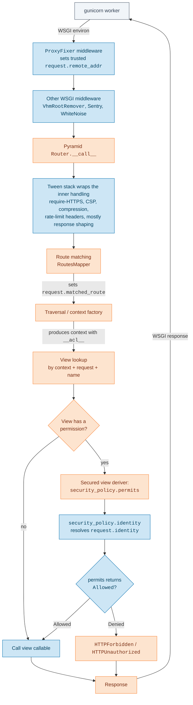
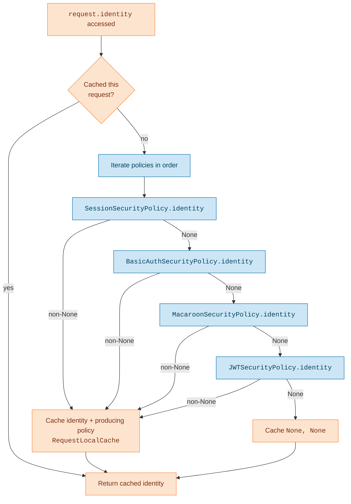
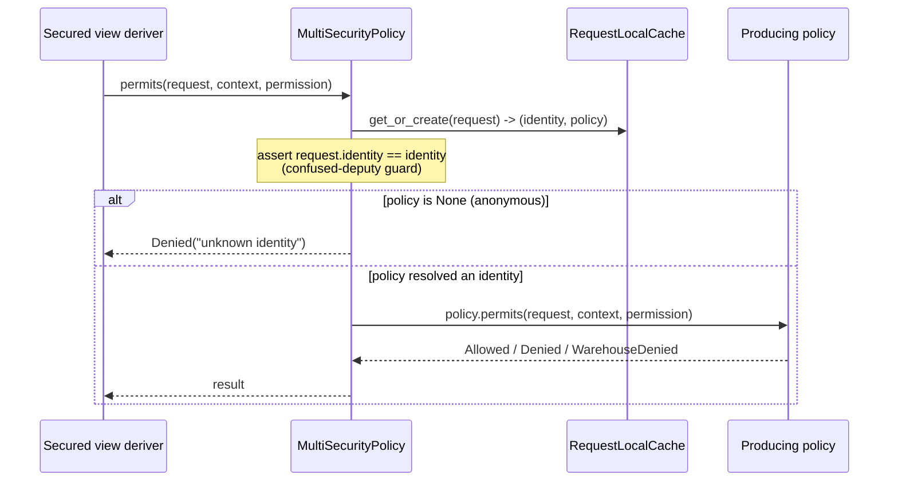
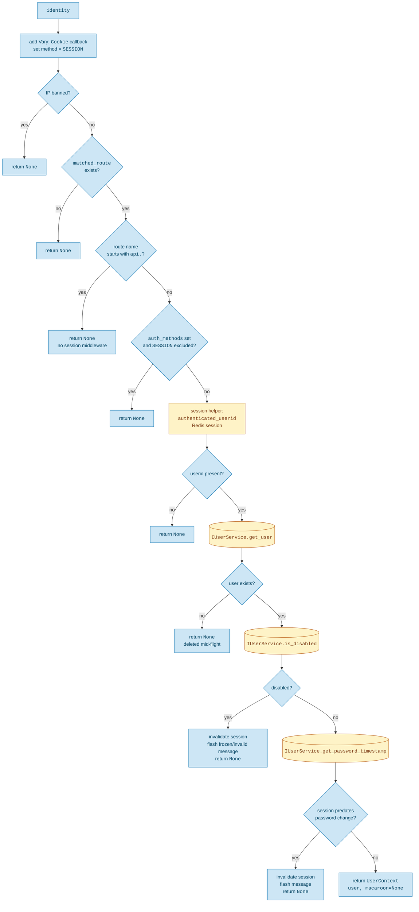
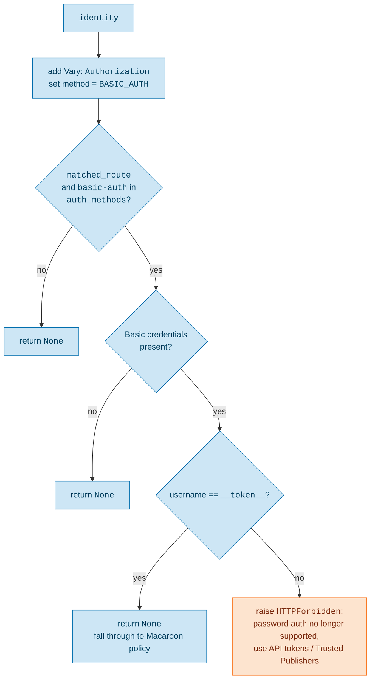
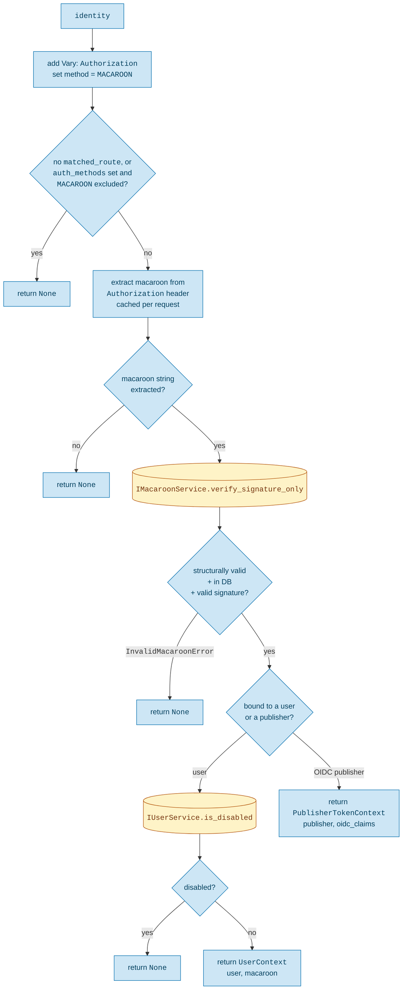
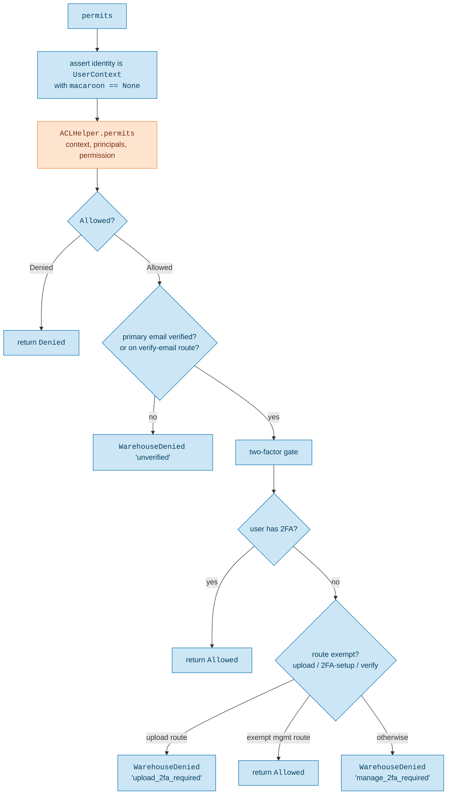
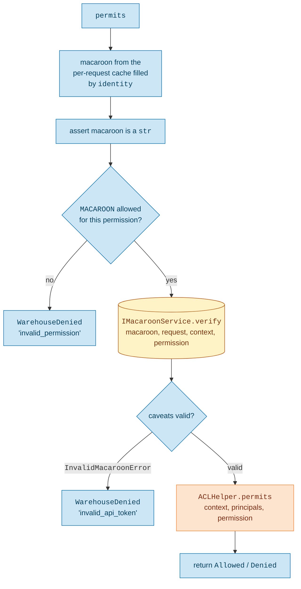
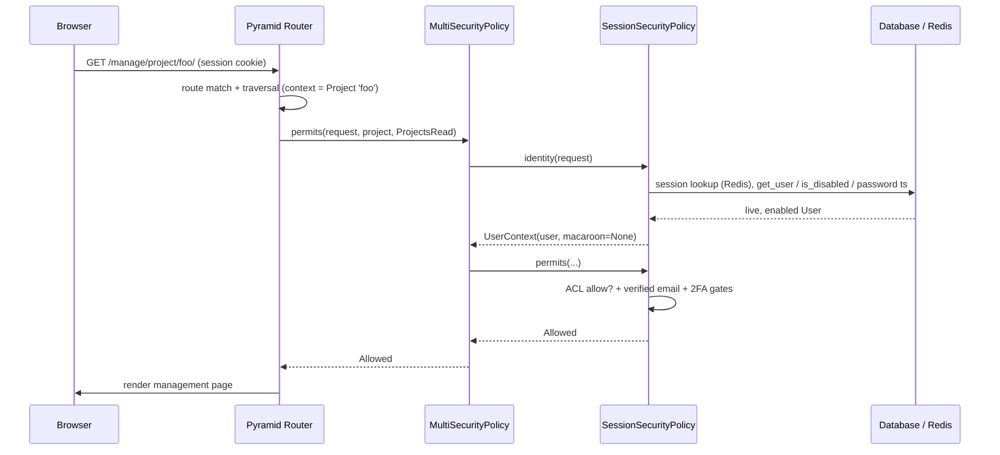
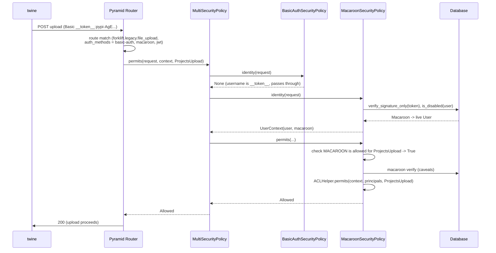

# Security Policy Flow

This document traces how an HTTP request is authenticated and authorized in
Warehouse, starting from the moment gunicorn hands a WSGI request to the
Pyramid application. It covers how Pyramid's internals call into our security
policies, how identities are resolved, and how ACLs and other gates (route
`auth_methods`, two-factor, verified email, macaroon caveats, and JWT
authorization details) combine to allow or deny a request.

> This list is the single place that maps the concepts below to files (linked on
> `main`). The prose and diagrams name symbols, not paths, so moving a file only
> means updating an entry here.

- [`warehouse/authnz/security_policy.py`](https://github.com/pypi/warehouse/blob/main/warehouse/authnz/security_policy.py): registers the policy stack (`config.set_security_policy`)
- [`warehouse/utils/security_policy.py`](https://github.com/pypi/warehouse/blob/main/warehouse/utils/security_policy.py): `MultiSecurityPolicy`, `AuthenticationMethod`, `principals_for`, and the `PERMISSION_AUTH_METHODS` table with its permission/method gate
- [`warehouse/accounts/security_policy.py`](https://github.com/pypi/warehouse/blob/main/warehouse/accounts/security_policy.py): `SessionSecurityPolicy`, `BasicAuthSecurityPolicy`, and the session authorization gates (verified email, two-factor)
- [`warehouse/accounts/utils.py`](https://github.com/pypi/warehouse/blob/main/warehouse/accounts/utils.py): `UserContext`
- [`warehouse/macaroons/security_policy.py`](https://github.com/pypi/warehouse/blob/main/warehouse/macaroons/security_policy.py): `MacaroonSecurityPolicy` (API tokens and Trusted Publishing)
- [`warehouse/jwt/security_policy.py`](https://github.com/pypi/warehouse/blob/main/warehouse/jwt/security_policy.py): JWT authentication and permission checks
- [`warehouse/jwt/verifier.py`](https://github.com/pypi/warehouse/blob/main/warehouse/jwt/verifier.py): token verification
- [`warehouse/jwt/services.py`](https://github.com/pypi/warehouse/blob/main/warehouse/jwt/services.py): route audience selection, the issued-token registry, and default services
- [`warehouse/jwt/issuer.py`](https://github.com/pypi/warehouse/blob/main/warehouse/jwt/issuer.py) and [`warehouse/jwt/signing.py`](https://github.com/pypi/warehouse/blob/main/warehouse/jwt/signing.py): token issuance and KMS signing
- [`warehouse/oidc/utils.py`](https://github.com/pypi/warehouse/blob/main/warehouse/oidc/utils.py): `PublisherTokenContext`
- [`warehouse/predicates.py`](https://github.com/pypi/warehouse/blob/main/warehouse/predicates.py): route metadata and helpers for `auth_methods` and `jwt_audience`
- [`warehouse/routes.py`](https://github.com/pypi/warehouse/blob/main/warehouse/routes.py) and [`warehouse/forklift/__init__.py`](https://github.com/pypi/warehouse/blob/main/warehouse/forklift/__init__.py): route declarations tagged with `auth_methods`
- [`warehouse/config.py`](https://github.com/pypi/warehouse/blob/main/warehouse/config.py): `RootFactory` (the default context and the root ACL)
- [`warehouse/utils/wsgi.py`](https://github.com/pypi/warehouse/blob/main/warehouse/utils/wsgi.py): `ProxyFixer` (trusted client IP) and `VhmRootRemover` WSGI middleware
- [`warehouse/errors.py`](https://github.com/pypi/warehouse/blob/main/warehouse/errors.py): `WarehouseDenied`
- [`warehouse/authnz/_permissions.py`](https://github.com/pypi/warehouse/blob/main/warehouse/authnz/_permissions.py): the `Permissions` enum used throughout the ACLs

## Diagram legend

The diagrams below share one color scheme:

- <span style="background-color:#fde4cf; border: 1px solid #f98131; padding: 2px 6px;">Pyramid</span> core machinery (router, traversal, view derivers, ACL helper, per-request cache)
- <span style="background-color:#cde6f5; border: 1px solid #006dad; padding: 2px 6px;">Warehouse</span> code (our security policies and the gates they wrap around the ACL)
- <span style="background-color:#fef3c7; border: 1px solid #b45309; padding: 2px 6px;">Service data</span> via `IUserService`/`IMacaroonService`, Postgres/Redis DBs, etc
- <span style="background-color:#f1f5f9; border: 1px solid #475569; padding: 2px 6px;">External actors</span> (gunicorn, browsers, CLI clients such as `twine`)

The colors apply to the flowcharts. The interaction diagrams are drawn as Mermaid
sequence diagrams, which Material renders with a single box fill, so those are left
uncolored; read the participant names for the same categories.

## 1. From gunicorn to the security policy

gunicorn speaks WSGI to the Warehouse application object.
That object is the Pyramid `Router`, wrapped in our own stack of WSGI
middleware and Pyramid tweens.

Most of that wrapping is transport and response shaping (compression, CSP and
referrer headers, conditional GETs, rate-limit headers) and has nothing to do
with who you are. The one piece that matters for auth is `ProxyFixer`, a WSGI
middleware that runs before the router and establishes the trusted
`request.remote_addr` from our proxy headers. `SessionSecurityPolicy` later
refuses to authenticate a banned IP, so that ban check is only as trustworthy
as `ProxyFixer`.

Authentication and authorization are not middleware. Permission checks run
inside the router after route matching and traversal, before a view declaring a
`permission` executes. Other code can also access `request.identity` directly,
including on routes without a view permission.



Two Pyramid concepts do the work here:

- **Traversal and the context factory.** Every route resolves to a *context*
  resource. By default that is the `RootFactory`, whose `__acl__` carries the
  site-wide admin grants. Routes that declare a
  `factory=` and `traverse=` (for example the project routes pointing at
  `ProjectFactory`) produce a domain object such as a `Project` as the context,
  and that object supplies its own `__acl__`.
- **The secured view deriver.** When a view is registered with a `permission`,
  Pyramid wraps it so that, before the view runs, it calls
  `security_policy.permits(request, context, permission)`. If the result is not
  `Allowed`, the view never executes and Pyramid raises `HTTPForbidden` (or
  `HTTPUnauthorized` for anonymous requests).

`request.identity` is the other entry point. It is computed lazily the first
time anything touches it (the permits machinery, a subscriber, `request.user`,
a template) by calling `security_policy.identity(request)`.

## 2. The policy stack: `MultiSecurityPolicy`

Pyramid 2.x uses a single `ISecurityPolicy` object that answers both
authentication (`identity`, `authenticated_userid`) and authorization
(`permits`). Warehouse registers a `MultiSecurityPolicy` that wraps four
concrete policies, tried in order:

```python
config.set_security_policy(
    MultiSecurityPolicy(
        [
            SessionSecurityPolicy(),
            BasicAuthSecurityPolicy(),
            MacaroonSecurityPolicy(),
            JWTSecurityPolicy(),
        ],
    )
)
```

`MultiSecurityPolicy` caches both the resolved identity *and the policy that
produced it* for the lifetime of the
request, using a `RequestLocalCache`. That pairing matters: the same policy
that authenticated the request is the one asked to authorize it.



The combinator semantics:

- `identity` is the first non-`None` result from the policies, in order.
- `authenticated_userid` returns the user id only when the identity is a
  `UserContext` (a deliberate contract bend, noted in a `TODO` in the code,
  because many views still use it as a "user or not" check).
- `forget` and `remember` are concatenated across all policies.
- `permits` is delegated to the single policy that produced the identity.

The `permits` path includes a confused-deputy guard: it re-reads the cached
`(identity, policy)` pair and asserts `request.identity == identity` before
dispatching, so a mismatch between the cached identity and the live request
identity fails loudly rather than silently authorizing the wrong principal.



## 3. Route `auth_methods`: deciding which policy may engage

A request to `/manage/account/` and a request to a forklift upload endpoint
should not be authenticated the same way. A browser cookie has no business
authenticating an upload, and an API token has no business driving the
management UI. The `auth_methods` route predicate makes that explicit on the
route itself.

`AuthMethodsPredicate` is a *storage-only* predicate. Its `__call__` always
returns `True`, so it never affects which route matches. It exists purely so the
security policies can read it back off `request.matched_route.predicates` via
`auth_methods_for_route(route)`. A route opts in by passing `auth_methods` to
`add_route` or `add_legacy_action_route`. The forklift upload route allows
macaroons, including the Basic `__token__` pass-through, and JWTs.

```python
config.add_legacy_action_route(
    "forklift.legacy.file_upload",
    "file_upload",
    auth_methods={"basic-auth", "macaroon", "jwt"},
    jwt_audience="upload",
    domain=forklift,
)
```

The danger API routes allow macaroons and JWTs and set `jwt_audience="api"`.
Listing `basic-auth` without `macaroon` raises a `ConfigurationError`, since
the only credential basic-auth lets through is a macaroon.

Each policy consults the predicate during `identity()`. JWT authentication also
requires a route audience and [configured verification keys](#jwt-configuration).

| Route declares | Session engages? | BasicAuth engages? | Macaroon engages? | JWT engages? |
|----------------|------------------|--------------------|-------------------|--------------|
| *(no `auth_methods`)* | yes | no (needs explicit opt-in) | yes | no |
| `{"basic-auth", "macaroon", "jwt"}` (forklift upload) | no | yes | yes | yes |
| `{"macaroon", "jwt"}` (danger API) | no | no | yes | yes |
| `{"api-key"}` (reserved placeholder) | no | no | no | no |
| `{"jwt"}` (JWT-only) | no | no | no | yes |

`auth_methods_for_route` returns `None` when a route carries no predicate, and
each policy decides its own default for that case. `SessionSecurityPolicy` and
`MacaroonSecurityPolicy` still engage on un-tagged routes, although the session
policy skips routes named `api.*`. `BasicAuthSecurityPolicy` only engages when a
route explicitly lists `basic-auth`.

## 4. Authentication: resolving `request.identity`

Every policy's `identity()` registers a `Vary` response callback (on `Cookie`
for sessions, `Authorization` for the header-based policies) so caches don't
serve one user's response to another. Session, BasicAuth, and Macaroon stamp
`request.authentication_method` up front. JWT stamps `JWT` only after
verification, the registry check, and subject resolution succeed.

### 4a. `SessionSecurityPolicy`

This is the browser path. The session itself is backed by Redis; the user
record and its security state come from the database via `IUserService`.



The database reads on the happy path are `get_user`, `is_disabled`, and
`get_password_timestamp`. A session can be cryptographically valid yet still be
rejected here because the underlying account was frozen, disabled, deleted, or
had its password changed after the session was minted.

### 4b. `BasicAuthSecurityPolicy`

HTTP Basic password auth is no longer accepted. This policy exists to turn it
into a clear error instead of a confusing failure, and to let API tokens pass
through to the macaroon policy.



This policy never produces an identity. It either declines (returning `None`)
or raises `HTTPForbidden`. The `__token__` username is the agreed sentinel that
means "the password field carries an API token", so it is passed through for
`MacaroonSecurityPolicy` to handle.

### 4c. `MacaroonSecurityPolicy`

This is the API path: `twine upload`, Trusted Publishing from CI, and other
token-authenticated API endpoints. The token arrives in the `Authorization`
header, either as `Basic` with username `__token__`, or as `token`/`bearer`.



Note that `identity()` here only proves the token *exists*, has a valid
signature, and maps to a live principal. It does not yet verify the macaroon's
caveats. That happens in `permits()`, because caveat verification depends on
the specific context and permission being requested.

### 4d. `JWTSecurityPolicy`

The policy reads `Authorization: Bearer <token>` on routes that allow `jwt`.
It leaves `pypi-` Bearer credentials to the macaroon policy. It caches the
credential so authentication and authorization use the same token.

1. `IJWTVerifier.verify` checks the signature and the [token profile](#jwt-profile).
   It returns immutable `VerifiedJWT` claims, or `None` for an invalid token.
2. `IJWTRegistry.get_active` loads the unexpired registry entry for the token's
   `jti`. A missing entry ends authentication. Database failures propagate.
3. The policy looks up the named subject kind and UUID. An enabled user yields
   a `UserContext`. An existing OIDC publisher yields a `PublisherTokenContext`
   with any upstream claims stored in `additional["oidc"]`. Warehouse exposes
   those claims as `request.oidc_claims`, for example to link upload history to
   a specific commit.

JWTs use the `JWT` authentication method. `API_KEY` is reserved for future use.

## 5. Authorization: how `permits` decides

Once an identity exists and the requested permission is known, the producing
policy's `permits()` runs. The session, macaroon, and JWT policies consult the
same ACL machinery (`pyramid.authorization.ACLHelper`), with different gates.
BasicAuth never produces an identity and therefore does not authorize requests.

### Principals and the ACL

`principals_for(identity)` asks the identity for its principals via
`__principals__()`:

- A `User` returns `[Authenticated, "user:<id>", ...group memberships]`, where
  groups like `group:admins`, `group:moderators`, `group:support`,
  `group:psf_staff`, and `group:observers` derive from account flags.
- A `PublisherTokenContext` returns `[Authenticated, "oidc:<publisher id>"]`.

`ACLHelper.permits(context, principals, permission)` walks the context's
`__acl__` list of `(Allow|Deny, principal, permissions)` entries and returns
`Allowed` or `Denied` based on the first matching entry. The context is
whatever traversal produced: `RootFactory` for site-wide permissions, or a
domain object such as a `Project` or `User` for object-scoped permissions.

### 5a. Session authorization



Two gates sit on top of the ACL result, and they only ever *downgrade* an
`Allowed` to a denial, never the reverse:

- **Verified email.** An `Allowed` becomes `WarehouseDenied("unverified")`
  unless the user has a verified primary email, with carve-outs for the
  verify-email and unverified-account routes so users can get unstuck.
- **Two-factor.** If the ACL allowed the action but the user has no 2FA
  configured, the request is denied, with a tailored message for the upload
  endpoint and exemptions for the routes used to set up 2FA.

### 5b. Macaroon authorization



The macaroon and JWT policies share the permission check
`permission_allowed_by_authentication_method`, backed by the
`PERMISSION_AUTH_METHODS` table:

```python
PERMISSION_AUTH_METHODS = {
    Permissions.ProjectsUpload: frozenset({MACAROON, BASIC_AUTH, JWT}),
    # Legacy macaroon support for API permissions is slated for removal.
    Permissions.APIEcho: frozenset({MACAROON, JWT}),
    Permissions.APIObservationsAdd: frozenset({MACAROON, JWT}),
}
```

Anything not in the table defaults to SESSION-only, so an API token cannot be
used to drive ordinary browser-flow permissions even if it somehow reached the
ACL. After that gate, `IMacaroonService.verify(...)` checks the macaroon's
embedded caveats against this specific request, context, and permission (for
example a token scoped to a single project, or an expiry caveat). Only then
does the same `ACLHelper.permits` run that the session path uses.

The macaroon `verify` is where Trusted Publishing caveats and project-scoped
token caveats are enforced, distinct from the ACL question of "does this
principal have this permission on this object".

### 5c. JWT authorization

`JWTSecurityPolicy.permits` checks the following in order:

1. The requested permission allows `JWT` in `PERMISSION_AUTH_METHODS`.
2. The original token still verifies, and its registry entry is still active.
3. The token's subject kind and UUID match the request identity. At least one
   authorization detail covers both the requested permission and the resource.
4. The resource ACL allows the action for the identity's principals.

The policy repeats the token and registry checks even when it has cached the
identity. A later check can deny an expired token or see a revocation committed
before its registry query. Work that already passed authorization can continue.

## 6. Two end-to-end examples

### Browser managing a project



### CLI upload with an API token



## 7. Key types at a glance

| Type | Meaning |
|------|---------|
| `MultiSecurityPolicy` | Tries policies in order, caches `(identity, policy)`, delegates `permits` |
| `UserContext` | A `User` plus an optional `Macaroon`; sessions and user-backed JWTs have `macaroon=None` |
| `PublisherTokenContext` | An OIDC publisher plus optional stored upstream claims (Trusted Publishing) |
| `AuthenticationMethod` | `SESSION`, `BASIC_AUTH`, `MACAROON`, `JWT` (verifier disabled by default), `API_KEY` (unimplemented placeholder) |
| `AuthMethodsPredicate` | Storage-only route tag listing which methods may authenticate the route |
| `PERMISSION_AUTH_METHODS` | Which auth methods may grant which permissions (default: session-only) |
| `WarehouseDenied` | A `Denied` subclass carrying a human message and a machine `reason` |
| `RootFactory` | Default context resource; its `__acl__` holds site-wide admin grants |

## 8. Things worth remembering

- Permission checks run inside the router, after route matching and traversal,
  before views that declare a `permission`. Code can also access identity on
  routes without a view permission. There is no authentication middleware.
- `identity()` proves *who* you are; `permits()` proves *what you may do*. For
  macaroons the split is sharper: existence and signature are checked in
  `identity()`, while caveats are checked in `permits()`.
- The same policy that authenticates a request authorizes it. The cached
  `(identity, policy)` pair plus the `request.identity == identity` assertion
  guard against confused-deputy mistakes.
- Route `auth_methods` controls which authentication methods can engage. JWT
  routes also declare `jwt_audience`; permissions must allow JWT in
  `PERMISSION_AUTH_METHODS`.
- The session path layers verified-email and two-factor gates on top of the
  ACL; the macaroon path layers the permission/method gate and caveat
  verification. Both can only turn an ACL `Allowed` into a denial, never widen
  it.

## Warehouse-issued JWTs

### JWT profile

Warehouse verifies tokens locally with configured RSA public keys. It checks
these headers and claims:

| Field | Requirement |
| --- | --- |
| JOSE header | Exactly `alg`, `typ`, and `kid`. Use `RS256`, `pypi-access+jwt`, and the ID of a configured RSA public key of at least 2048 bits. |
| `iss`, `aud` | Exact matches for the configured issuer and audience. `aud` must be a single string. |
| `sub`, `subject_kind` | A canonical Warehouse UUID and either `user` or `publisher`. |
| `jti` | A canonical UUID. The registry generates UUIDv7 IDs at issuance. |
| `iat`, `exp`, optional `nbf` | Integer Unix timestamps in seconds. Warehouse rejects future `iat` or `nbf` values and expired tokens, with zero clock tolerance. `exp - iat` must be between 1 and 300 seconds inclusive. |
| `authorization_details` | A nonempty array of the objects described below. |

Before parsing, Warehouse checks that the compact token is unpadded ASCII and at
most 8 KiB.

Warehouse rejects extra headers and claims, including keys or key URLs supplied
by the token. The type identifies PyPI access tokens. The issuer and audience
identify where a token is accepted.

#### Authorization details

Warehouse uses the JWT claim from [RFC 9396, section 9.1](https://www.rfc-editor.org/rfc/rfc9396.html#section-9.1)
with its own allowed values:

- `type` must be `"warehouse"`.
- `actions` must contain at least one permission. Supported values are
  `projects:upload`, `api:observations:add`, and `api:echo`.
- `identifier` is optional. Use `"project:<canonical UUID>"` to restrict all
  actions in that object to one project. Only uploads and observations support
  this restriction. Omit the field to leave the project unrestricted by the
  token.

An invalid object, including an unknown field or a null or malformed identifier,
invalidates the entire token. Only project identifiers are supported.

Each object grants its actions independently. List projects in separate objects
to grant the same action on several projects. For project actions, omitting
the identifier covers every project the ACL allows.

For example, an upload token can allow two specific projects:

```json
{
  "authorization_details": [
    {
      "type": "warehouse",
      "actions": ["projects:upload"],
      "identifier": "project:95ea64e2-764c-4320-a4e5-991df49f261f"
    },
    {
      "type": "warehouse",
      "actions": ["projects:upload"],
      "identifier": "project:c024d4a7-807f-4b5d-abab-b02bf3f3f80c"
    }
  ]
}
```

An API token for observations on any project can use
`{"type": "warehouse", "actions": ["api:observations:add"]}` as its sole
authorization detail.

Uploads and observations require an existing `Project` context and the relevant
ACL permissions. Reporting an observation requires observer privileges.
Warehouse's OIDC exchange omits `identifier` for uploads, so each upload uses
the publisher's current project associations. The token stays the same size
regardless of how many projects the publisher can access.

### JWT configuration

Set `JWT_VERIFICATION_KEYS` to enable verification. Without it, Warehouse uses
`DisabledJWTVerifier`, which rejects every JWT.

| Environment variable | Setting | Value |
| --- | --- | --- |
| `JWT_ISSUER` | `warehouse.jwt.issuer` | Expected `iss` value for this environment |
| `JWT_UPLOAD_AUDIENCE` | `warehouse.jwt.upload_audience` | Expected `aud` value for uploads |
| `JWT_API_AUDIENCE` | `warehouse.jwt.api_audience` | Expected `aud` value for the API, distinct from the upload audience |
| `JWT_VERIFICATION_KEYS` | `warehouse.jwt.verification_keys` | JSON object mapping JWT key IDs to PEM-encoded RSA public keys |
| `JWT_SIGNING_KEY_ID` | `warehouse.jwt.signing_key_id` | Key ID to put in the JWT header. It must appear in the verification key mapping. |
| `JWT_KMS_KEY_ID` | `warehouse.jwt.kms_key_id` | AWS KMS key ID, ARN, or alias for an RSA `SIGN_VERIFY` key |

Warehouse validates the issuer, audiences, and public keys at startup. Use
separate issuers, audience values, and keys for each environment. Reload
Warehouse after changing these settings. For incoming Trusted Publishing
assertions, set the upstream audience separately with `OIDC_AUDIENCE`.

A route that accepts JWTs declares both `auth_methods` and `jwt_audience`:

```python
config.add_route(
    "api.echo",
    "/danger-api/echo",
    auth_methods={"macaroon", "jwt"},
    jwt_audience="api",
)
```

Once Pyramid matches a route, the verifier uses that route's `jwt_audience`
label to select the configured audience. The label is metadata only.

| Route | `jwt_audience` |
| --- | --- |
| `forklift.legacy.file_upload` | `"upload"` |
| `api.echo` | `"api"` |
| `api.projects.observations` | `"api"` |

### Issued-token registry

The `issued_jwts` table stores the UUIDv7 token ID, an indexed `expires_at`,
and an `additional` JSONB object for metadata, which defaults to `{}`.
`get_active` returns the entry and its metadata. `is_active` checks for an
unexpired entry. Both query PostgreSQL so they can see committed revocations.
To revoke a token, delete its row.

Issuing code can store data such as filtered OIDC claims in
`additional["oidc"]`. Use this data for provenance, such as upload history.
Permissions come from signed claims and the ACL. Persist any data needed
after the registry entry is deleted in the relevant upload or event record.

The hourly cleanup task deletes rows at least five minutes after expiration.
A five-minute token therefore expires five minutes after issuance and becomes
eligible for cleanup after ten minutes.

### JWT signing and rotation

Set both `JWT_SIGNING_KEY_ID` and `JWT_KMS_KEY_ID` to enable issuance. At
startup, Warehouse calls `kms:GetPublicKey`, checks that the returned key matches
the configured public key for the JWT key ID, and pins the KMS key ARN. With
both settings omitted, Warehouse uses `DisabledJWTIssuer` and can verify
tokens without contacting KMS.

The caller of `IJWTIssuer` authorizes issuance and chooses the subject, audience
label, and authorization details. It can also supply registry metadata and a
lifetime of 1–300 seconds (default 300). The issuer validates the claims,
registers the token ID, and passes the claims to `IJWTSigner`. The issuer rejects
signed tokens over 8 KiB. The token and its row use the same expiration. The
issuer returns the token, ID, and expiration in `SignedJWT`. The caller owns the
transaction and must commit the registry write before handing out the token.

The production signer uses the AWS SDK credential chain and configured region.
Give the issuing workload `kms:GetPublicKey` and `kms:Sign` on the chosen RSA
`SIGN_VERIFY` key. KMS holds the private key and signs a SHA-256 digest using
`RSASSA_PKCS1_V1_5_SHA_256`. Signing errors fail issuance. Development uses the
[Compose KMS emulator](../development/getting-started.md#local-jwt-signing).
Tests use a test-only signer with its own RSA key.

To rotate without interrupting verification:

1. Create a new RSA `SIGN_VERIFY` key. Grant the issuing workload access and
   fetch the public key.
2. Add the new public key under a new JWT key ID in `JWT_VERIFICATION_KEYS` and
   reload all verifiers. Keep the old public key.
3. Deploy the new `JWT_SIGNING_KEY_ID` and set `JWT_KMS_KEY_ID` to the new key's
   ARN or an alias dedicated to that key. Running issuers use the ARN resolved
   at startup. If a shared alias moves, an issuer that restarts with the old
   key ID will fail the public key check.
4. After the last issuer stops using the old key, wait at least five minutes
   plus a margin for deployment and clock differences. Remove the old public
   key and signing permissions, then reload the verifiers.

If a key is compromised, remove its public key from every verifier's
configuration. In the same rollout, switch issuers using that key to a
configured replacement or unset both `JWT_SIGNING_KEY_ID` and `JWT_KMS_KEY_ID`.
If no verification keys remain, unset `JWT_VERIFICATION_KEYS`. Tokens signed
with the compromised key stop verifying as each verifier reloads.

### Trusted Publisher exchange and revocation

The [trial guide](../development/trusted-publisher-jwt-trial.md) shows how clients
request, use, and burn an upload JWT. A pending publisher can create the
project during exchange. Uploading with a JWT requires an existing project.

With the real OIDC backend, Warehouse verifies the provider's assertion and
resolves the publisher before issuing either a JWT or a macaroon. Warehouse
also records the upstream assertion's `jti` when present to prevent replay.
Request a fresh assertion after a signing failure, since Warehouse may already
have recorded the previous identifier.

For burn requests, Warehouse selects the upload verifier explicitly. It checks
the token in the JSON body, requires an unexpired publisher JWT with an active
entry, then deletes that entry. The JWT can revoke itself even after its
publisher has been deleted. The request transaction includes the deletion and
any project history events.
