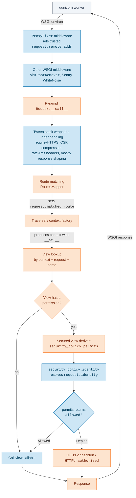
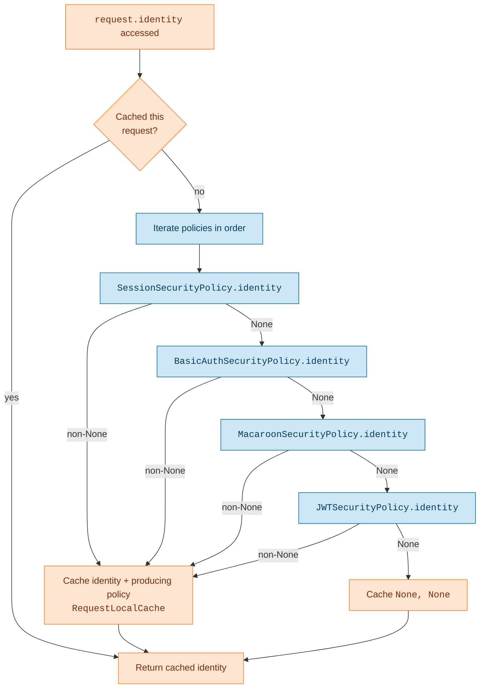
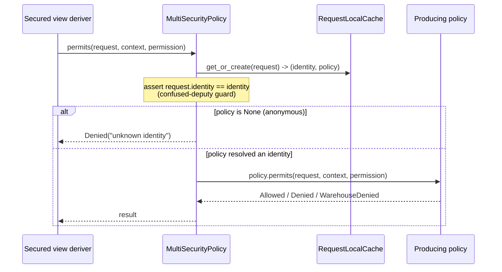
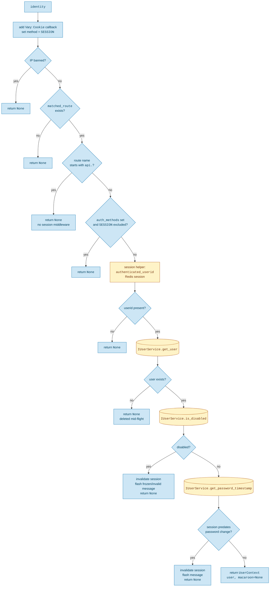
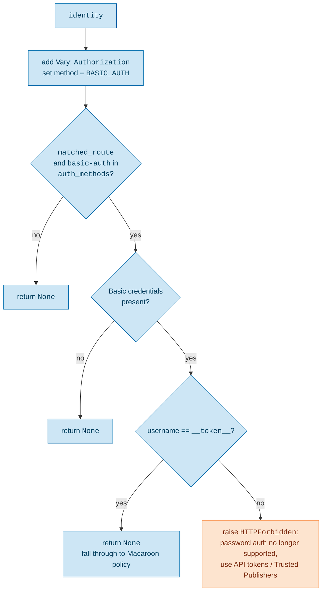
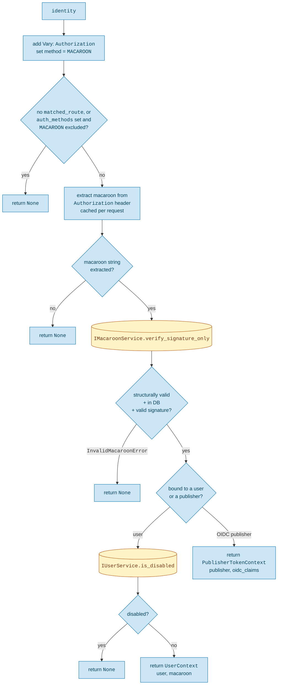
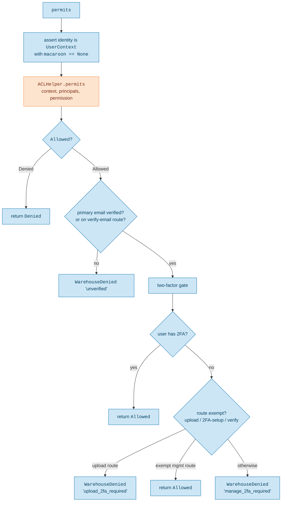
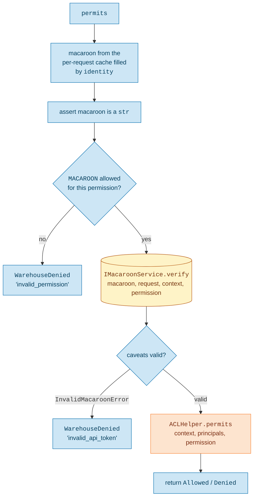
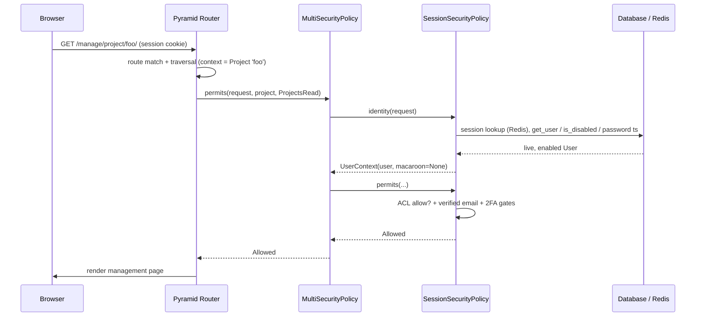
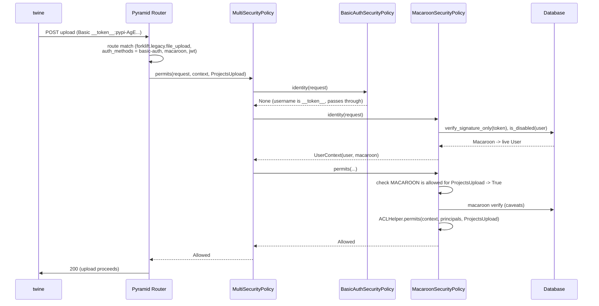

# Security Policy Flow

This document traces how an HTTP request is authenticated and authorized in
Warehouse, starting from the moment gunicorn hands a WSGI request to the
Pyramid application. It covers how Pyramid's internals call into our security
policies, how identities are resolved, and how ACLs and the other gates (route
`auth_methods`, two-factor, verified email, macaroon caveats) combine to allow
or deny a request.

> This list is the single place that maps the concepts below to files (linked on
> `main`). The prose and diagrams name symbols, not paths, so moving a file only
> means updating an entry here.

- [`warehouse/authnz/security_policy.py`](https://github.com/pypi/warehouse/blob/main/warehouse/authnz/security_policy.py): registers the policy stack (`config.set_security_policy`)
- [`warehouse/utils/security_policy.py`](https://github.com/pypi/warehouse/blob/main/warehouse/utils/security_policy.py): `MultiSecurityPolicy`, `AuthenticationMethod`, `principals_for`, and the `PERMISSION_AUTH_METHODS` table with its permission/method gate
- [`warehouse/accounts/security_policy.py`](https://github.com/pypi/warehouse/blob/main/warehouse/accounts/security_policy.py): `SessionSecurityPolicy`, `BasicAuthSecurityPolicy`, and the session authorization gates (verified email, two-factor)
- [`warehouse/accounts/utils.py`](https://github.com/pypi/warehouse/blob/main/warehouse/accounts/utils.py): `UserContext`
- [`warehouse/macaroons/security_policy.py`](https://github.com/pypi/warehouse/blob/main/warehouse/macaroons/security_policy.py): `MacaroonSecurityPolicy` (API tokens and Trusted Publishing)
- [`warehouse/jwt/security_policy.py`](https://github.com/pypi/warehouse/blob/main/warehouse/jwt/security_policy.py): `JWTSecurityPolicy` (JWT authentication)
- [`warehouse/jwt/interfaces.py`](https://github.com/pypi/warehouse/blob/main/warehouse/jwt/interfaces.py) and [`warehouse/jwt/services.py`](https://github.com/pypi/warehouse/blob/main/warehouse/jwt/services.py): the JWT verifier and registry contracts, their services, and the rejecting default verifier
- [`warehouse/jwt/verifier.py`](https://github.com/pypi/warehouse/blob/main/warehouse/jwt/verifier.py): `WarehouseJWTVerifier`, the opt-in verifier for Warehouse-issued JWTs
- [`warehouse/jwt/issuer.py`](https://github.com/pypi/warehouse/blob/main/warehouse/jwt/issuer.py): the opt-in signing configuration and request-scoped `WarehouseJWTIssuer`
- [`warehouse/jwt/__init__.py`](https://github.com/pypi/warehouse/blob/main/warehouse/jwt/__init__.py): JWT service registration and registry cleanup scheduling
- [`warehouse/oidc/utils.py`](https://github.com/pypi/warehouse/blob/main/warehouse/oidc/utils.py): `PublisherTokenContext`
- [`warehouse/predicates.py`](https://github.com/pypi/warehouse/blob/main/warehouse/predicates.py): `AuthMethodsPredicate` and the `auth_methods_for_route` helper
- [`warehouse/routes.py`](https://github.com/pypi/warehouse/blob/main/warehouse/routes.py) and [`warehouse/forklift/__init__.py`](https://github.com/pypi/warehouse/blob/main/warehouse/forklift/__init__.py): route declarations tagged with `auth_methods`
- [`warehouse/config.py`](https://github.com/pypi/warehouse/blob/main/warehouse/config.py): `RootFactory` (the default context and the root ACL)
- [`warehouse/utils/wsgi.py`](https://github.com/pypi/warehouse/blob/main/warehouse/utils/wsgi.py): `ProxyFixer` (trusted client IP) and `VhmRootRemover` WSGI middleware
- [`warehouse/errors.py`](https://github.com/pypi/warehouse/blob/main/warehouse/errors.py): `WarehouseDenied`
- [`warehouse/authnz/_permissions.py`](https://github.com/pypi/warehouse/blob/main/warehouse/authnz/_permissions.py): the `Permissions` enum used throughout the ACLs

## Diagram legend

The diagrams below share one color scheme:

- <span style="background-color:#fde4cf; border: 1px solid #f98131; padding: 2px 6px;">Pyramid</span> core machinery (router, traversal, view derivers, ACL helper, per-request cache)
- <span style="background-color:#cde6f5; border: 1px solid #006dad; padding: 2px 6px;">Warehouse</span> code (our security policies and the gates they wrap around the ACL)
- <span style="background-color:#fef3c7; border: 1px solid #b45309; padding: 2px 6px;">Service data</span> via `IUserService`/`IMacaroonService`, Postgres/Redis DBs, etc
- <span style="background-color:#f1f5f9; border: 1px solid #475569; padding: 2px 6px;">External actors</span> (gunicorn, browsers, CLI clients such as `twine`)

The colors apply to the flowcharts. The interaction diagrams are drawn as Mermaid
sequence diagrams, which Material renders with a single box fill, so those are left
uncolored; read the participant names for the same categories.

## 1. From gunicorn to the security policy

gunicorn speaks WSGI to the Warehouse application object.
That object is the Pyramid `Router`, wrapped in our own stack of WSGI
middleware and Pyramid tweens.

Most of that wrapping is transport and response shaping (compression, CSP and
referrer headers, conditional GETs, rate-limit headers) and has nothing to do
with who you are. The one piece that matters for auth is `ProxyFixer`, a WSGI
middleware that runs before the router and establishes the trusted
`request.remote_addr` from our proxy headers. `SessionSecurityPolicy` later
refuses to authenticate a banned IP, so that ban check is only as trustworthy
as `ProxyFixer`.

Authentication and authorization themselves **are not middleware**. They run
*inside* the router, after the route and the context resource have been
resolved, and only when a view declares a `permission`.



Two Pyramid concepts do the work here:

- **Traversal and the context factory.** Every route resolves to a *context*
  resource. By default that is the `RootFactory`, whose `__acl__` carries the
  site-wide admin grants. Routes that declare a
  `factory=` and `traverse=` (for example the project routes pointing at
  `ProjectFactory`) produce a domain object such as a `Project` as the context,
  and that object supplies its own `__acl__`.
- **The secured view deriver.** When a view is registered with a `permission`,
  Pyramid wraps it so that, before the view runs, it calls
  `security_policy.permits(request, context, permission)`. If the result is not
  `Allowed`, the view never executes and Pyramid raises `HTTPForbidden` (or
  `HTTPUnauthorized` for anonymous requests).

`request.identity` is the other entry point. It is computed lazily the first
time anything touches it (the permits machinery, a subscriber, `request.user`,
a template) by calling `security_policy.identity(request)`.

## 2. The policy stack: `MultiSecurityPolicy`

Pyramid 2.x uses a single `ISecurityPolicy` object that answers both
authentication (`identity`, `authenticated_userid`) and authorization
(`permits`). Warehouse registers a `MultiSecurityPolicy` that wraps four
concrete policies, tried in order:

```python
config.set_security_policy(
    MultiSecurityPolicy(
        [
            SessionSecurityPolicy(),
            BasicAuthSecurityPolicy(),
            MacaroonSecurityPolicy(),
            JWTSecurityPolicy(),
        ],
    )
)
```

`MultiSecurityPolicy` caches both the resolved identity *and the policy that
produced it* for the lifetime of the
request, using a `RequestLocalCache`. That pairing matters: the same policy
that authenticated the request is the one asked to authorize it.



The combinator semantics:

- `identity` is the first non-`None` result from the policies, in order.
- `authenticated_userid` returns the user id only when the identity is a
  `UserContext` (a deliberate contract bend, noted in a `TODO` in the code,
  because many views still use it as a "user or not" check).
- `forget` and `remember` are concatenated across all policies.
- `permits` is delegated to the single policy that produced the identity.

The `permits` path includes a confused-deputy guard: it re-reads the cached
`(identity, policy)` pair and asserts `request.identity == identity` before
dispatching, so a mismatch between the cached identity and the live request
identity fails loudly rather than silently authorizing the wrong principal.



## 3. Route `auth_methods`: deciding which policy may engage

A request to `/manage/account/` and a request to a forklift upload endpoint
should not be authenticated the same way. A browser cookie has no business
authenticating an upload, and an API token has no business driving the
management UI. The `auth_methods` route predicate makes that explicit on the
route itself.

`AuthMethodsPredicate` is a *storage-only* predicate. Its `__call__` always
returns `True`, so it never affects which route matches. It exists purely so the
security policies can read it back off `request.matched_route.predicates` via
`auth_methods_for_route(route)`. A route opts in by passing `auth_methods` to
`add_route` or `add_legacy_action_route`. The forklift upload, for example,
accepts basic-auth (for the `__token__` pass-through) and macaroons, and declares
support for the `jwt` method:

```python
config.add_legacy_action_route(
    "forklift.legacy.file_upload",
    "file_upload",
    auth_methods={"basic-auth", "macaroon", "jwt"},
    jwt_audience="upload",
    domain=forklift,
)
```

The danger-API routes pass `auth_methods={"macaroon", "jwt"}` instead.
`JWTSecurityPolicy` implements `jwt`, but its default `DisabledJWTVerifier`
rejects every token. `API_KEY` remains a distinct, unimplemented placeholder:
it neither enables JWT authentication nor grants permissions. JWT authentication
remains disabled unless explicitly configured. The Trusted Publisher upload trial
supports opt-in issuance, Bearer uploads, and self-revocation; see the
[trial guide](../development/trusted-publisher-jwt-trial.md).
Listing `basic-auth` without `macaroon` raises a `ConfigurationError`, since
the only credential basic-auth lets through is a macaroon.

Each policy consults the predicate during `identity()` and bows out when its
method is not in the route's allowed set:

| Route declares | Session engages? | BasicAuth engages? | Macaroon engages? | JWT engages? |
|----------------|------------------|--------------------|-------------------|--------------|
| *(no `auth_methods`)* | yes | no (needs explicit opt-in) | yes | no |
| `{"basic-auth", "macaroon", "jwt"}` (forklift upload) | no | yes | yes | yes |
| `{"macaroon", "jwt"}` (danger API) | no | no | yes | yes |
| `{"api-key"}` (reserved placeholder) | no | no | no | no |
| `{"jwt"}` (JWT-only) | no | no | no | yes |

`auth_methods_for_route` returns `None` when a route carries no predicate, and
each policy decides its own default for that case. `SessionSecurityPolicy` and
`MacaroonSecurityPolicy` still engage on un-tagged routes; `BasicAuthSecurityPolicy`
only engages when a route explicitly lists `basic-auth`. `JWTSecurityPolicy`
requires an explicit `jwt` declaration and a Bearer credential that is not
a `pypi-` macaroon. Engaging does not imply success: the default verifier rejects
all credentials.

## 4. Authentication: resolving `request.identity`

Every policy's `identity()` registers a `Vary` response callback (on `Cookie`
for sessions, `Authorization` for the header-based policies) so caches don't
serve one user's response to another. Session, BasicAuth, and Macaroon stamp
`request.authentication_method` up front. JWT stamps `JWT` only after
verification and account checks succeed.

### 4a. `SessionSecurityPolicy`

This is the browser path. The session itself is backed by Redis; the user
record and its security state come from the database via `IUserService`.



The database reads on the happy path are `get_user`, `is_disabled`, and
`get_password_timestamp`. A session can be cryptographically valid yet still be
rejected here because the underlying account was frozen, disabled, deleted, or
had its password changed after the session was minted.

### 4b. `BasicAuthSecurityPolicy`

HTTP Basic password auth is no longer accepted. This policy exists to turn it
into a clear error instead of a confusing failure, and to let API tokens pass
through to the macaroon policy.



This policy never produces an identity. It either declines (returning `None`)
or raises `HTTPForbidden`. The `__token__` username is the agreed sentinel that
means "the password field carries an API token", so it is passed through for
`MacaroonSecurityPolicy` to handle.

### 4c. `MacaroonSecurityPolicy`

This is the API path: `twine upload`, Trusted Publishing from CI, and other
token-authenticated API endpoints. The token arrives in the `Authorization`
header, either as `Basic` with username `__token__`, or as `token`/`bearer`.



Note that `identity()` here only proves the token *exists*, has a valid
signature, and maps to a live principal. It does not yet verify the macaroon's
caveats. That happens in `permits()`, because caveat verification depends on
the specific context and permission being requested.

### 4d. `JWTSecurityPolicy`

The JWT policy runs after the existing policies, preserving their precedence.
It accepts only Bearer credentials on routes explicitly allowing `jwt`;
Basic and Token headers and `pypi-` Bearer macaroons are ignored. Extraction
does not decode or trust claims. The extracted credential is cached per request
so authorization uses the same token that established the identity.

`IJWTVerifier.verify(token)` must validate the signature, trusted issuer and
keys, allowed algorithm, audience, token purpose, required claims, and time
bounds before returning an immutable `VerifiedJWT`. Its typed subject, JTI,
issuer, audience, UTC timestamps, and normalized authorization details contain no
request or database models. Invalid tokens return `None`; infrastructure or
configuration failures raise. Verification does not establish a live identity
or grant access by itself. After verification, the policy checks
`IJWTRegistry.get_active(verified.jti)` before resolving the subject. Missing,
expired, or revoked registry entries cannot authenticate; database errors
propagate rather than allowing access.

The policy resolves the explicitly named subject kind: `user` loads a current,
enabled user and returns `UserContext(user, None)`; `publisher` loads an existing
OIDC publisher and returns `PublisherTokenContext` with the registry entry's
`additional["oidc"]` metadata, if present. A missing
subject never falls back to another kind, even if its UUID exists in that table.
Publisher identities retain their `oidc:<id>` principals, not user principals.
Like macaroon authentication, the publisher's filtered per-run OIDC claims are
exposed as `request.oidc_claims`, for example to build commit-specific publisher
URLs in upload history. They do not grant permissions and are not JWT claims.

Like the macaroon policy, the JWT policy caches the identity and original
credential, not a successful validation result. Authorization rechecks token
validity and registry liveness even when the request has already authenticated.
Expiration or a revocation committed before the registry query prevents a later
permission check from succeeding within that same request. This does not cancel
work that has already passed authorization.

Authorization requires all three gates to pass, in order:

1. The `JWT` authentication-method permission allowlist.
2. Fresh verification of the original token and a fresh registry liveness check,
   followed by `warehouse.jwt.authorization.permits`, which binds the subject
   kind and ID to the resolved identity and checks the requested permission and
   any resource narrowing attached to the same authorization details object.
3. The existing resource ACL evaluated with the identity's current principals.

The default `DisabledJWTVerifier` always returns `None` from `verify`.
`WarehouseJWTVerifier` implements the following initial
Warehouse-issued token profile, but requires explicit configuration to enable:

- JOSE headers are exactly `alg`, `typ`, and `kid`. The algorithm is fixed to
  `RS256`, the type must be `pypi-access+jwt`, and the key ID must identify
  a trusted RSA public key supplied to the verifier. Keys must be at least
  2048 bits. Tokens cannot supply keys, key URLs, or JOSE extensions.
  The type identifies PyPI access tokens, not a particular environment or
  endpoint; issuer and audience checks provide that separation.
- `iss` and `aud` must exactly match the issuer and single audience supplied
  to the verifier. Audience arrays are rejected. `sub` is a canonical Warehouse
  UUID and the required `subject_kind` is either `user` or `publisher`.
- `jti` is a required canonical UUID identifying the issued credential. Issuance
  uses the registry's UUIDv7 IDs; this claim alone does not prove registration.
- `iat` and `exp` are required integer NumericDates. Optional `nbf` is also an
  integer. Future issuance/not-before times and expired tokens are rejected,
  with no clock-skew allowance. The issued lifetime must satisfy
  `0 < exp - iat <= 300`: exactly five minutes is allowed, but anything longer
  is rejected even in its final five minutes. `nbf` does not shorten the issued
  lifetime for this check. The verifier rechecks validity on every authorization
  call that passes the method allowlist, even if request identity is cached.
- `authorization_details` is a required, nonempty array, using the JWT claim
  described by [RFC 9396 section 9.1](https://www.rfc-editor.org/rfc/rfc9396.html#section-9.1).
  Warehouse defines a small profile of its
  [common fields](https://www.rfc-editor.org/rfc/rfc9396.html#section-2.2):

    - `type` is required and must be exactly `"warehouse"`. It identifies this
      authorization profile, not the subject kind or token audience.
    - `actions` is a required, nonempty array containing only `projects:upload`,
      `api:observations:add`, and/or `api:echo`.
    - `identifier` is optional. If absent, there is no token-level resource
      restriction on these actions. If present, it must be
      `"project:<canonical UUID>"` and narrows **every action in this object**
      to that project. This is supported for uploads and observations, not echo.
      Null, empty, wildcard, malformed, and unsupported identifiers are rejected,
      never treated as absent.

  The type value, action vocabulary, identifier syntax, and meaning of an absent
  identifier are Warehouse conventions, not prescribed by the RFC.
- Authorization still requires the subject's live ACL privileges. Uploads and
  observations require an actual `Project` context, regardless of whether the
  token names a project. Observations can target any project when the subject
  has observer privileges; being an owner, maintainer, or Trusted Publisher does
  not confer those privileges.
- Objects are additive. Each object's identifier restricts only its own actions:
  upload on project A plus observations on project B does not permit upload on B.
  A narrowed object does not constrain another object with the same action and
  no identifier. To issue a narrower token, omit that broader authorization.
- This profile accepts only `type`, `actions`, and optional `identifier` inside
  each object. Other RFC fields such as `locations`, `datatypes`, and
  `privileges` are unsupported, as are unknown types, actions, and restrictions.
  Any invalid object or action rejects the whole token, even if another is valid.
  Unknown top-level claims and the previous experimental `grants`,
  `permissions`/`project_ids`, and `scope` claims are rejected too.
- JWT upload authorization requires an existing `Project` context, so an upload
  request cannot create the project. A pending Trusted Publisher exchange can
  create the project before issuing the JWT. Organization identities and
  organization resource identifiers are unsupported. Adding a type, action, or
  resource kind requires explicit validation, resolution/authorization, and tests.

For example, the authorization claim for reporting observations on any project
(still requiring observer privileges) is:

```json
{
  "authorization_details": [
    {
      "type": "warehouse",
      "actions": ["api:observations:add"]
    }
  ]
}
```

An upload token restricted to a specific project uses:

```json
{
  "authorization_details": [
    {
      "type": "warehouse",
      "actions": ["projects:upload"],
      "identifier": "project:95ea64e2-764c-4320-a4e5-991df49f261f"
    }
  ]
}
```

For publisher-wide uploads, omit `identifier` from that upload object. Token size
then remains independent of project count. The same unexpired token can upload
to projects added to the publisher after issuance; removing the publisher from
a project removes access. Archived/quarantined projects still deny uploads.
Users likewise remain limited to their live ACL privileges. Named-project
identifiers remain useful when issuance should restrict a token regardless of
later membership additions.

This adopts the RFC's authorization-details representation, not a complete OAuth
Rich Authorization Requests protocol implementation. Issuance, consent, metadata,
and introspection flows are not introduced here.

Subject identity and authorization scope are independent. A future
organization-scoped grant need not make the organization the token's subject;
the actor can remain a user or publisher. Resource matching belongs to the
authorization layer, not to cryptographic verification.

The constructor accepts `issuer`, `audience`, and a `keys` mapping from key ID
to parsed RSA public key. Multiple keys can be supplied for rotation. It makes
no network requests. Bad configuration and operational errors raise rather
than being treated as invalid credentials. Authorization binds the verified
subject to the authenticated identity; authorization details still cannot bypass
the live user/publisher resource ACL. Objects without identifiers deliberately
follow live privileges; an identifier keeps its object's actions restricted to
the named project. Removing a publisher from a project removes the ACL permission
in either case.

Each environment uses one issuer and separate audiences for the upload endpoint
and the API (initially the danger API). Upload tokens must not authenticate API
requests, and API tokens must not authenticate uploads, even if their permissions
would otherwise allow the operation. Permissions and project scopes further
restrict operations within the intended recipient; an audience match alone does
not grant permission.
Deployment configuration supplies the concrete issuer and audience values.

Supply the expected issuer and recipient-specific audience explicitly to each
verifier and require exact matches. `WarehouseJWTVerifierFactory` selects the
verifier using the matched route's trusted `jwt_audience` declaration, never the
token's claimed audience or a value constructed from the request's host or path:

| Route | `jwt_audience` |
| --- | --- |
| `forklift.legacy.file_upload` | `"upload"` |
| `api.echo` | `"api"` |
| `api.projects.observations` | `"api"` |

Declare the named audience next to `auth_methods` when adding a route:

```python
config.add_route(
    "api.echo",
    "/danger-api/echo",
    auth_methods={"macaroon", "jwt"},
    jwt_audience="api",
)
```

Like `auth_methods`, `jwt_audience` is storage-only metadata and does not affect
route matching. Its only valid values are `"upload"` and `"api"`; other values
fail application configuration. These labels select deployment-configured
audiences; they are not literal `aud` claim values or strings supplied by the
client.

The route must also explicitly allow `jwt` authentication. Missing routes or
routes without an audience declaration receive a rejecting verifier. Route names
and prefixes do not imply an audience, and adding or renaming routes requires no
change to the verifier.

Neither recipient should accept both audiences as a global allowlist, and
multi-audience tokens remain rejected. Issuers and audience values must be
distinct across environments, with separate signing keys between environments.
This profile does not use the `warehouse.oidc.audience` setting, which is for
incoming third-party Trusted Publishing assertions.

`DisabledJWTVerifier` remains the default, even when issuer, audience, and key
settings are supplied. The configuration surface for explicitly opting in is:

| Setting | Environment variable | Value |
| --- | --- | --- |
| `warehouse.jwt.enabled` | `JWT_ENABLED` | Boolean; defaults to false |
| `warehouse.jwt.issuer` | `JWT_ISSUER` | Exact issuer for this environment |
| `warehouse.jwt.upload_audience` | `JWT_UPLOAD_AUDIENCE` | Exact upload audience |
| `warehouse.jwt.api_audience` | `JWT_API_AUDIENCE` | Exact API audience, distinct from upload |
| `warehouse.jwt.verification_keys` | `JWT_VERIFICATION_KEYS` | Mapping of key IDs to PEM RSA public-key strings; JSON in the environment variable |
| `warehouse.jwt.signing_key_id` | `JWT_SIGNING_KEY_ID` | Optional active signing key ID; must exist in the verification key mapping |
| `warehouse.jwt.signing_key` | `JWT_SIGNING_KEY` | Optional PEM RSA private key (unencrypted, at least 2048 bits); must match the public key for the signing key ID |

When enabled, startup validates the configuration and loads the public keys.
Missing/invalid settings, shared upload/API audiences, private keys,
non-RSA keys, and RSA keys smaller than 2048 bits fail configuration rather than
silently disabling verification. Multiple key IDs support overlapping
verification keys during rotation. Changing settings or keys requires rebuilding
the application configuration; no token-supplied URL or key is loaded.

`warehouse.jwt` provides a database-backed registry with a UUIDv7 `id`
(for the JWT's `jti`), indexed `expires_at`, and an `additional` JSONB object
defaulting to `{}`. Its request-scoped `IJWTRegistry` service registers fresh IDs,
fetches active entries with metadata (`get_active`), checks existence and expiration
without loading metadata (`is_active`), and revokes IDs by deleting their rows.
Both lookups query the database freshly, even when a row is already in the ORM
identity map. Registration and revocation participate
in the caller's transaction; commit before returning a token or acknowledging
revocation. An hourly task deletes expired rows, but expiration is enforced even
if cleanup has not run. Metadata is set by trusted issuing code, namespaced by
purpose, and never overrides signed claims or grants permissions. For example,
Trusted Publisher issuance can store
`{"oidc": publisher.stored_claims(verified_upstream_claims)}` without storing the
upstream credential or copying this metadata into the Warehouse JWT. Cleanup
removes metadata with the row; persist anything needed long-term in upload/event
records. The registry does not replace signature, audience, scope, or live
resource authorization checks.

`IJWTIssuer` is a server-side signing service, not an exchange endpoint. It is
disabled by default. Enabling verification alone does not require a private key:
`DisabledJWTIssuer` remains registered unless `warehouse.jwt.enabled` is true and
signing configuration is supplied. Supplying only one signing setting or an
invalid/mismatched key fails application configuration. Private keys are loaded
once from trusted secret configuration and must not be logged or exposed.

An authorized server-side caller selects a typed `SubjectRef`, an audience name
(`"upload"` or `"api"`, resolved through configuration), and typed authorization
details. It can also supply registry-only `additional` metadata and a lifetime
of 1–300 integer seconds (default 300). `WarehouseJWTIssuer` validates the profile,
registers a new JTI, then signs with `RS256`, the configured key ID, and the
`pypi-access+jwt` type. JWT and registry expiration use the same UTC
integer-second timestamp. The returned immutable `SignedJWT` contains `token`,
`jti`, and `expires_at`; the service never commits. The caller must commit before
handing out the credential and roll back on failure. Issuance itself neither
authenticates an upstream identity nor authorizes the requested grants.

The Trusted Publisher exchange issues a publisher subject
with the upload audience and an authorization detail containing
`actions=[Permissions.ProjectsUpload]` and no resource restriction. Live publisher
project associations still govern uploads, without enumerating projects in the
token. Supplying project-restricted details remains supported when narrowing is
required. Signing key rotation selects a new key ID while retaining old public
keys long enough to verify outstanding tokens.

The OIDC exchange accepts an optional `token_format` of `"macaroon"` (the default)
or `"jwt"`. Unknown formats fail payload validation. JWT opt-in requires an enabled
`IJWTIssuer`; unavailable issuance is rejected before publisher reification or
upstream replay-token consumption, without falling back to a macaroon. Provider
verification, publisher matching, pending-publisher handling, replay protection,
events, and notifications remain shared between formats.

The JWT exchange chooses the publisher subject, upload audience, a permission-wide
`projects:upload` authorization detail, and a five-minute lifetime on the server.
The client cannot select those claims. Filtered `stored_claims` go into the
registry's `additional["oidc"]`, not the JWT. The response keeps the existing
`success`, `token`, and integer `expires` fields; default macaroons retain their
15-minute lifetime. Use JWTs as `Authorization: Bearer <token>`, never Basic
`__token__` credentials.

The burn endpoint also accepts a Warehouse JWT in its existing `{"token": "..."}`
JSON payload. It uses the named `IJWTVerifier` service `"upload"`, explicitly bound
by server code to the upload audience independently of request route metadata.
This does not opt the burn route into JWT authentication. Only a correctly signed,
unexpired publisher JWT with an active registry entry may delete its own JTI;
user JWTs and API-audience JWTs cannot. Publisher deletion does not prevent
self-revocation. Invalid, expired, absent, or already-burned credentials retain
the same HTTP 202 response; database failures propagate and must not be reported
as successful revocation. The caller's transaction commits deletion and events.

The JWT policy enforces registry liveness at authentication and authorization;
the cryptographic verifier remains independent of the database. Functional tests
cover the publisher exchange, upload, history/provenance, and burn flow. Publisher
JWTs use the existing publisher upload path; the exchange does not issue user JWTs.
User-backed upload issuance would need a separate integration pass over the upload
handler's macaroon-specific behavior, email requirements, and MFA requirements.
Deployment activation remains explicit and disabled by default. The verifier
enforces the five-minute lifetime limit; the general registry does not define
token-profile lifetime policy.

## 5. Authorization: how `permits` decides

Once an identity exists and the requested permission is known, the producing
policy's `permits()` runs. All four policies ultimately consult the
same ACL machinery (`pyramid.authorization.ACLHelper`), but they wrap it with
different gates.

### Principals and the ACL

`principals_for(identity)` asks the identity for its principals via
`__principals__()`:

- A `User` returns `[Authenticated, "user:<id>", ...group memberships]`, where
  groups like `group:admins`, `group:moderators`, `group:support`,
  `group:psf_staff`, and `group:observers` derive from account flags.
- A `PublisherTokenContext` returns `[Authenticated, "oidc:<publisher id>"]`.

`ACLHelper.permits(context, principals, permission)` walks the context's
`__acl__` list of `(Allow|Deny, principal, permissions)` entries and returns
`Allowed` or `Denied` based on the first matching entry. The context is
whatever traversal produced: `RootFactory` for site-wide permissions, or a
domain object such as a `Project` or `User` for object-scoped permissions.

### 5a. Session authorization



Two gates sit on top of the ACL result, and they only ever *downgrade* an
`Allowed` to a denial, never the reverse:

- **Verified email.** An `Allowed` becomes `WarehouseDenied("unverified")`
  unless the user has a verified primary email, with carve-outs for the
  verify-email and unverified-account routes so users can get unstuck.
- **Two-factor.** If the ACL allowed the action but the user has no 2FA
  configured, the request is denied, with a tailored message for the upload
  endpoint and exemptions for the routes used to set up 2FA.

### 5b. Macaroon authorization



The macaroon path has its own front gate,
`permission_allowed_by_authentication_method`, backed by the
`PERMISSION_AUTH_METHODS` table:

```python
PERMISSION_AUTH_METHODS = {
    Permissions.ProjectsUpload: frozenset({MACAROON, BASIC_AUTH, JWT}),
    # Legacy macaroon support for API permissions is slated for removal.
    Permissions.APIEcho: frozenset({MACAROON, JWT}),
    Permissions.APIObservationsAdd: frozenset({MACAROON, JWT}),
}
```

Anything not in the table defaults to SESSION-only, so an API token cannot be
used to drive ordinary browser-flow permissions even if it somehow reached the
ACL. After that gate, `IMacaroonService.verify(...)` checks the macaroon's
embedded caveats against this specific request, context, and permission (for
example a token scoped to a single project, or an expiry caveat). Only then
does the same `ACLHelper.permits` run that the session path uses.

The macaroon `verify` is where Trusted Publishing caveats and project-scoped
token caveats are enforced, distinct from the ACL question of "does this
principal have this permission on this object".

## 6. Two end-to-end examples

### Browser managing a project



### CLI upload with an API token



## 7. Key types at a glance

| Type | Meaning |
|------|---------|
| `MultiSecurityPolicy` | Tries policies in order, caches `(identity, policy)`, delegates `permits` |
| `UserContext` | A `User` plus an optional `Macaroon`; sessions and user-backed JWTs have `macaroon=None` |
| `PublisherTokenContext` | An OIDC publisher plus optional stored upstream claims (Trusted Publishing) |
| `AuthenticationMethod` | `SESSION`, `BASIC_AUTH`, `MACAROON`, `JWT` (verifier disabled by default), `API_KEY` (unimplemented placeholder) |
| `AuthMethodsPredicate` | Storage-only route tag listing which methods may authenticate the route |
| `PERMISSION_AUTH_METHODS` | Which auth methods may grant which permissions (default: session-only) |
| `WarehouseDenied` | A `Denied` subclass carrying a human message and a machine `reason` |
| `RootFactory` | Default context resource; its `__acl__` holds site-wide admin grants |

## 8. Things worth remembering

- Authentication and authorization run inside the router, after route matching
  and traversal, and only for views that declare a `permission`. There is no
  authentication middleware.
- `identity()` proves *who* you are; `permits()` proves *what you may do*. For
  macaroons the split is sharper: existence and signature are checked in
  `identity()`, while caveats are checked in `permits()`.
- The same policy that authenticates a request authorizes it. The cached
  `(identity, policy)` pair plus the `request.identity == identity` assertion
  guard against confused-deputy mistakes.
- Route `auth_methods` is the lever for keeping browser, password, and token
  auth from bleeding across surfaces. Adding a new authenticated API surface
  means a new `AuthenticationMethod` and a `PERMISSION_AUTH_METHODS` entry, not
  a new `MACAROON` grant.
- The session path layers verified-email and two-factor gates on top of the
  ACL; the macaroon path layers the permission/method gate and caveat
  verification. Both can only turn an ACL `Allowed` into a denial, never widen
  it.
